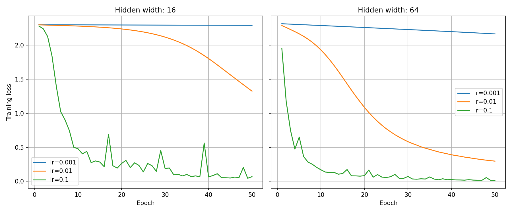

# Lab 2: A Neural Network from Scratch

## Goal

The goal of this lab is to build a two-hidden-layer neural network
from scratch, check its gradients, train it with different settings,
and compare forward and backward execution times.

## Method

- **Data:** I used the `load_digits` dataset. Each image has 64 input
  features. Pixel values were divided by 16, and labels were one-hot
  encoded. The data was split into 1,257 training and 540 test samples
  using a stratified 70/30 split with `random_state=42`.
- **Environment:** Python 3.11.8 was used in a virtual environment.
  Package versions are recorded in `results/versions.txt`.
- **Network:** The network has two hidden layers with ReLU activation
  and a 10-unit output layer with softmax. I tested hidden widths of
  16 and 64.
- **Parameter shapes:** The weight shapes are `(64, W)`, `(W, W)` and
  `(W, 10)`. The bias shapes are `(W,)`, `(W,)` and `(10,)`, where
  `W` is 16 or 64.
- **Initialisation:** Weights were drawn from a normal distribution
  with mean 0 and variance 0.01. Biases were initialised to zero.
- **Gradient check:** I compared analytical gradients with numerical
  gradients for 10 randomly selected weights per width, using
  `epsilon=1e-5`. The required relative error was below `1e-6` for at
  least 9 of the 10 weights.
- **Training:** I trained for 50 epochs with mini-batches of 32,
  shuffling the training data each epoch. I tested learning rates
  0.001, 0.01 and 0.1 for each width.
- **Timing:** I measured forward and backward passes separately on
  a batch of 32, using one warm-up and the median of 100 runs.
- **Seeds:** Python, NumPy, PyTorch and CUDA seeds were set to 42
  for training, timing and the network and gradient checks.

  ### Backpropagation gradients

For a batch of N samples, P is the softmax output and Y contains
the one-hot labels. The gradients are:

- Output layer:
  - `dZ3 = (P - Y) / N`
  - `dW3 = A2.T @ dZ3`
  - `db3 = sum(dZ3, axis=0)`
- Second hidden layer:
  - `dZ2 = (dZ3 @ W3.T) * (Z2 > 0)`
  - `dW2 = A1.T @ dZ2`
  - `db2 = sum(dZ2, axis=0)`
- First hidden layer:
  - `dZ1 = (dZ2 @ W2.T) * (Z1 > 0)`
  - `dW1 = X.T @ dZ1`
  - `db1 = sum(dZ1, axis=0)`

  ## Results

### Initial checks

For both hidden widths, the forward output had shape `(32, 10)`, and
each row summed to 1 within the required tolerance.

The untrained loss was 2.3042 for width 16 and 2.3257 for width 64,
close to the expected value of approximately 2.3026.

### Gradient check

| Hidden width | Passed checks |
|---:|---:|
| 16 | 10/10 |
| 64 | 10/10 |

Some sampled gradients were zero in both calculations: 2 for width 16
and 4 for width 64. All sampled non-zero gradients also passed.

### Final test accuracy

| Hidden width | Learning rate | Test accuracy |
|---:|---:|---:|
| 16 | 0.001 | 0.2167 |
| 16 | 0.01 | 0.5685 |
| 16 | 0.1 | 0.9481 |
| 64 | 0.001 | 0.3574 |
| 64 | 0.01 | 0.9000 |
| 64 | 0.1 | 0.9611 |

### Training loss curves

### Forward and backward timing

Median execution time over 100 runs, using a batch of 32:

| Hidden width | Forward (ms) | Backward (ms) |
|---:|---:|---:|
| 16 | 0.018100 | 0.019200 |
| 64 | 0.037900 | 0.049400 |

In this measurement, backward took longer than forward for both widths.
Backpropagation calculates weight gradients and passes gradients to
earlier layers, which involves additional matrix multiplications.
The matrix multiplications were not timed separately.

## Conclusions

1. In these experiments, the 0.1 learning rate gave the highest final
   test accuracy for both hidden widths.

2. With the same learning rate, the network with 64 hidden units had
   higher test accuracy than the network with 16 hidden units.

3. In the timing measurements, the backward pass took longer than the
   forward pass for both hidden widths.