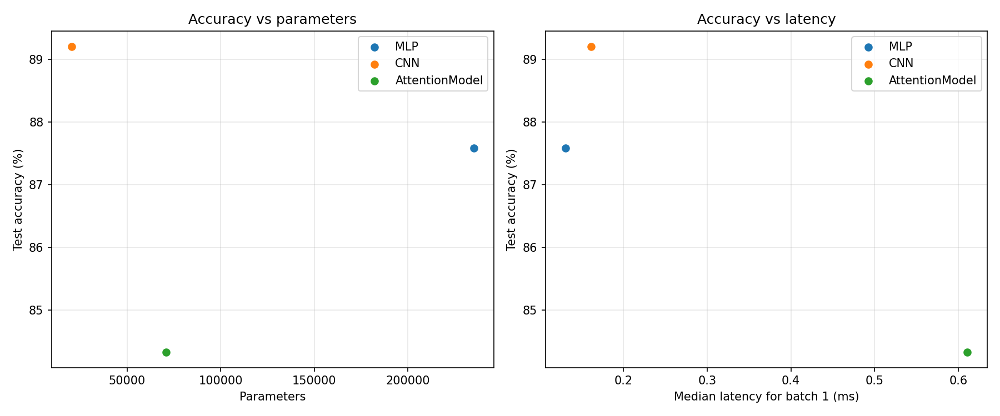

# Lab 3: Architectures and Their Costs

## Goal

The goal of this lab is to compare MLP, CNN and attention models
on Fashion-MNIST in terms of accuracy, parameters, FLOPs and latency.

## Method

- **Data:** Fashion-MNIST with 55,000 training, 5,000 validation
  and 10,000 test images. Images were converted to tensors and
  normalized using mean 0.2860 and standard deviation 0.3530.
- **Environment:** Python 3.11.8 and PyTorch 2.3.1. The experiments
  were run on CPU. Package versions are in `results/versions.txt`.
- **Models:** I implemented the MLP, CNN and two-layer Transformer
  encoder described in the lab manual.
- **Seeds:** Python, NumPy, PyTorch and CUDA seeds were set to 42
  in the relevant scripts.
- **Training:** Each model was trained for 5 epochs with Adam,
  learning rate 0.001 and batch size 128.
- **FLOPs:** I calculated matrix multiplication and convolution
  operations by hand and compared them with `thop`. One
  multiply-accumulate operation was counted as 2 FLOPs.
- **Latency:** I measured inference on CPU in evaluation mode.
  For batch 1 I used 100 runs; for batch 128 I used 20 runs.
  Each measurement had one warm-up, and I recorded the median.
  The timing script used newly initialized models.

## Results

### Parameters and test accuracy

| Model | Parameters | Test accuracy |
|---|---:|---:|
| MLP | 235,146 | 0.8759 |
| CNN | 20,490 | 0.8921 |
| Attention | 70,794 | 0.8433 |

The manual gives a target of 100,000–150,000 parameters, but the
specified layer sizes produced the counts above. I kept the
architectures as specified and reported their actual counts.

### FLOP comparison

For one layer of each type, my hand calculations were:

- Linear: 2 × 784 × 256 = 401,408 FLOPs.
- Convolution: 2 × 3 × 3 × 16 × 32 × 14 × 14 = 1,806,336 FLOPs.
- Attention: QKV projections = 393,216 FLOPs; attention scores
  = 32,768 FLOPs.
  
| Model | Hand calculation | thop, 2 × MACs |
|---|---:|---:|
| MLP | 469,504 | 469,504 |
| CNN | 2,063,488 | 2,063,488 |
| Attention | 2,329,856 | 101,632 |

The hand calculations count the main matrix multiplications and
convolutions. They do not include every operation, such as bias
addition or activation functions.

For the attention model, `thop` reported zero operations for the
encoder in this measurement. Its total therefore misses encoder
operations and is not a complete FLOP count.

### Inference latency

Median time in milliseconds per batch:

| Model | Batch 1: 100 runs | Batch 128: 20 runs |
|---|---:|---:|
| MLP | 0.130750 | 0.477200 |
| CNN | 0.161150 | 3.651500 |
| Attention | 0.610800 | 2.579050 |

### Trade-off plots

The accuracy–latency plot uses the batch 1 measurements.

### Architecture trade-offs

The MLP uses dense layers, so each output in a layer uses all
inputs from the previous layer. It had the most parameters but
the lowest batch 1 latency in this experiment.

The CNN uses small convolution kernels that are reused across
image positions. It had the fewest parameters and the highest
test accuracy, although its batch 128 latency was higher than
the other two models.

The attention model compares image patches with each other.
It had fewer parameters than the MLP, but its batch 1 latency
was the highest in this measurement. Parameter count alone
does not determine execution time.

## Conclusions

1. The CNN had the highest test accuracy and the fewest parameters
   among the three models in this experiment.

2. The MLP had the lowest batch 1 latency, even though it had the
   highest parameter count.

3. The attention model had the highest batch 1 latency. The `thop`
   result also showed that profiling tools may miss operations.